<p align="center">
  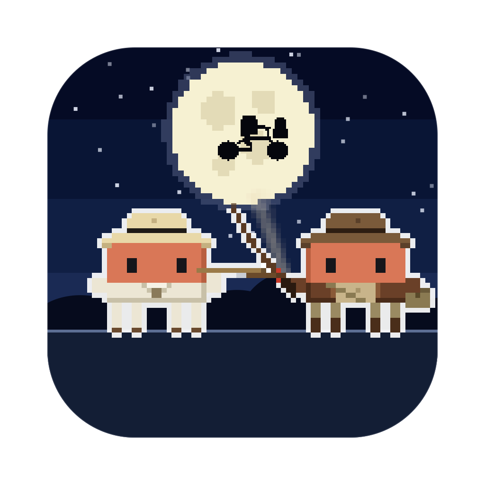
</p>

<h1 align="center">Stevie Clawdberg</h1>

<p align="center">
  <b>Your AI coding sessions, as a pixel-art blockbuster on your desktop.</b><br>
  Every session is a hero or a villain from the big adventure films, every subagent joins in, and they fight while they work.
</p>

<p align="center">
  <a href="LICENSE"></a>
  
  
  
  <a href="https://github.com/rodclemen/clawd-clash"></a>
</p>

VIDEO_URL_PLACEHOLDER

<p align="center"><sub>🔊 <b>Click the speaker in the player for sound</b>: GitHub starts videos muted. Full 1080p version: <a href="promo/stevie-clawdberg-promo.mp4">promo/stevie-clawdberg-promo.mp4</a></sub></p>

> **Stevie Clawdberg is a universe of [Clawd Clash](https://github.com/rodclemen/clawd-clash).** Same crew, same fights, more universes to switch to. This page shows off the Stevie Clawdberg universe; see [Get it](#get-it) to install.

<p align="center">
  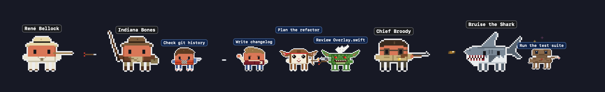
</p>

---

## Contents

- [What it is](#what-it-is)
- [The Stevie Clawdberg universe](#the-stevie-clawdberg-universe)
- [The cast](#the-cast)
- [Window mode](#window-mode)
- [Screen saver](#screen-saver)
- [Get it](#get-it)
- [More universes](#more-universes)
- [What's new](#whats-new)

## What it is

You run Claude Code in three terminals. One is thinking, one is waiting for your permission, one finished ten minutes ago and you didn't notice. You alt-tab around to find out.

**Clawd Clash tells you at a glance, without switching windows.** Every session becomes a character in a pixel-art blockbuster, along the bottom of your screen or in a window of its own: Claude Code's, and those of the other AIs and harnesses Clawd Clash supports ([the full list](https://github.com/rodclemen/clawd-clash#supported-ais-and-harnesses)).

- 🎬 **Working?** Your Claude cracks its whip, fires its revolver, flings a pie tin, or sends a remote-controlled DeLorean racing at the enemy.
- 💭 **Thinking?** A thought bubble.
- ❗ **Needs you?** A red `!`, and if you ignore it for a minute, it starts jumping up and down. It keeps asking until you answer; press Esc instead and it stands down.
- 😴 **Done and idle?** It stops fighting and passes the time with habits of its own: Indiana Bones cracks his whip and knocks his own hat off, Marty McFry duck-walks through a guitar solo, Doc Brawn claps a hand to his head ("Great Scott!"), Chunk does the Truffle Shuffle, Einstein the Dog checks his watch, a glass of water ripples in front of T. Wrecks with every step he takes, and Captain Clawk jumps at every tick of the Croc Clock. After a couple of minutes it sits down; after five it's asleep (zZz).
- 🧭 **Spawned subagents?** Every subagent gets to be a Goonie (or a gremlin, a raptor or a pirate): they walk in one by one, each labelled with what it's doing, and leave when they finish.
- 🔍 **Hover** any character for the details: status, how long, the tool it's running, your last prompt.
- 🖱️ **Click** any of them to jump straight to that session's terminal or editor tab.

No dashboard to open, no tab to check. It's just… there. Roads? Where we're going, we don't need roads.

## The Stevie Clawdberg universe

Run two Claudes and they square off. Every character is Clawd (Claude Code's little pixel mascot) in costume, and the fights follow the weapons:

| Matchup | What happens |
|---|---|
| a power (E.Clawd's glowing finger, Keyz's flashlight, Mola Ramm's fire, Tinkerbelle's pixie dust) vs a gun | the gunner gets hit |
| a power vs a whip, sword, claws or jaws | the weapon catches it |
| a gun vs a whip, sword, claws or jaws | shots fly, and each one gets knocked away into the sky |
| whip, sword, claws or jaws vs the same | they close in and fight it out |
| gun vs gun | a proper shoot-out: they duck and the bullets collide mid-air |
| odd one out | cheers the others on |

Doc Brawn puts on his brainwave analyser and steers a little remote-controlled DeLorean at the enemy on two trails of fire. E.Clawd never fires anything: he points his glowing fingertip, and whoever he points at glows.

**Arch-enemies face off first.** Whenever a pair is on stage together, everyone else shuffles aside so the two of them can have it out: Indiana Bones and René Bellock, Marty and Mad Dog Tannin, Doc Brawn and Old Biff, George McFry and Biff, Billy and Strype, Gizmoe and Mohawk, E.Clawd and Keyz, Chief Broody and Bruise the Shark, Mikey and Mama Fratelly, Ian Malclawm and T. Wrecks, Muldune and Clever Girl ("Clever girl…"), Peter Panning and Captain Clawk, and more.

**Indy shoots first.** When Indiana Bones and the Cairo Swordsman face off, the sword flashes, Indy puts the whip away, draws his revolver and fires. The swordsman goes head over heels, gets up complaining about his twirl, and Indy mutters that he doesn't have time for this.

**Their own rides.** When an agent is done, its ride comes for it. For Back to the Future's people it's the DeLorean, crackling blue, its gull-wing door lifting to let them in before it's gone in two lines of fire:

<p align="center">
  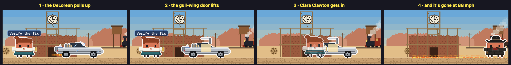
</p>

The E.T. kids and the Goonies fly off on the moon bike, the little alien in the basket; Jurassic Park's people leave in the park jeep. Close Encounters' people walk up into the mothership's light:

<p align="center">
  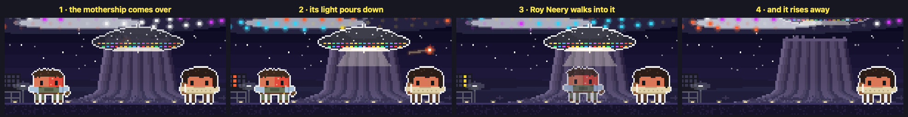
</p>

**88 mph.** When a Claude session playing one of Back to the Future's time travellers (Marty, Doc Brawn, Jennifer, Einstein the Dog, or Old Biff, who stole the DeLorean himself) compacts its context (when it runs out of room, or you type `/compact`), blue sparks crackle over them, a white flash and they're gone, two lines of fire burning on the ground where they went. A beat later three sonic booms bring them back where they stood, as OUTATIME types itself out over their head. Same session, same face.

<p align="center">
  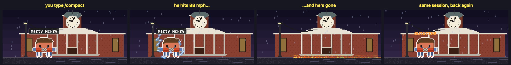
</p>

**Practice, Stevie Clawdberg's way.** A Claude working with nobody to fight works through practice sets: Indy cracks his whip at a bottle on a post, Squint harpoons a yellow barrel, Data tries out his spring-loaded boxing glove, Roofio lunges with his sword, and Marty plays a guitar solo with a duck-walk hop. Nobody in this universe floats cross-legged in meditation.

**Heroes against villains.** Run Claude Code alongside another AI and they pick sides: Claude Code plays the heroes, the others the villains, and each one's agents fight for their own side. The outline colour round each character tells you which AI it belongs to.

## The cast

54 villains and 63 heroes (plus one rare guest), any of whom can be a session (drawn large) or an agent (drawn small), from nine films: Jaws, Close Encounters, Indiana Jones, E.T., Hook, Jurassic Park, Gremlins, The Goonies and Back to the Future.

**The heroes**: Indiana Bones (cracks his whip and knocks his own hat off), Marion Ravenwould (downs a shot), Short Rounds, Willie Scoot (screams at a beetle), Sallaw (sings), Henry Bones Sr. (scatters gulls with his umbrella), Marcus Brodie (lost with his map), the Grail Knight, Mutt Willclaws (combs his quiff) and Helena Shore; Marty McFry (guitar solo, *"Nobody calls me chicken!"*), Doc Brawn (*"Great Scott!"*), Jennifer Parka, George McFry (one punch), Lorraine Baynes, Einstein the Dog (checks his watch), Clara Clawton (her telescope) and Goldie Wilsun (*"I'm gonna be mayor!"*); Billy Peltclawd, Kate Beringer (camera flash), Gizmoe (hums), Rand Peltclawd (his juicer), Lynn Peltclawd, Mr. Wing, Murray Futterclaw and Grandpa Dread; the Goonies: Mikey Waltz (his inhaler), Brand, Chunk (the Truffle Shuffle), Mouth, Data (the Pinchers of Peril), Andy, Stef and Slawth (tears his shirt open); Alan Grand, Ellie Saddler (at the breaker box), Ian Malclawm (his flare), John Hammend (his amber), Muldune (*"Clever girl…"*), Tim and Lex Murphey, Ray Arnie, Owen Gravy (calms a raptor with his palm), Claire Daring, Blue and Trike; E.Clawd (his heart glows, *"Phone… home"*), Elliclawd on his bike and Gurtie (screams); Chief Broody (*"Smile!"*), Hoopah (crushes his cup) and Squint (crushes his can); Roy Neery (the mashed-potato mountain), Jillian Geyser, Little Barry (his toys come to life), Clawd Lacombe (the five hand signs) and the Tall Visitor; Peter Panning (crows), Tinkerbelle, Roofio, Thud Butt (rolls into a cannonball), Jack Banning (hits a home run) and Tootles. And now and then HEM turns up in a fedora and a leather jacket with a bullwhip.

**The villains**: René Bellock (the golden idol), Major Tote (his coat hanger), the Cairo Swordsman, the Flying-Wing Mechanic, Mola Ramm (the Sankara stone), Lao Chay, Colonel Vogle, Walter Donnervan (drinks from the wrong cup), Elsa Snyder, Irina Spalco (the crystal skull), Jürgen Vollar and the Maharajah (his voodoo doll); Biff Tannin, Old Biff (the almanac), Griff Tannin (on his hoverboard), Mad Dog Tannin (shoots at your feet, *"Dance! Come on, runt!"*), Mr. Stricklaw and Needles; the gremlins: Strype, Mohawk (grows spider legs), the Brain (conducts), the Bat Gremlin, the Electric Gremlin, Greta and Daffy; Mrs. Deegle (her stair-lift) and Dr. Clawtheter; Keyz and the Spacesuit Man with their flashlights; Bruise the Shark (circles) and Mayor Vaun; Mama, Jake and Francis Fratelly, Troy and Elgin Perkins, and One-Eyed Willy on his gold; T. Wrecks (roars as the banner falls), Clever Girl (works the door handle), Spitter, Dennis Nerdry (*"Uh uh uh!"*), the Indominous Rex (fades into camouflage), Donald Gennarrow (hides in the toilet hut) and Dr. Woo; Major Mild Bill and the Gas-Mask Trooper; Captain Clawk (smashes a clock), Mr. Smeeh and Bill Jukes. A Compy, a mogwai pup, a Well of Souls snake, a biology-class frog and the Croc Clock only ever turn up as agents.

<p align="center">
  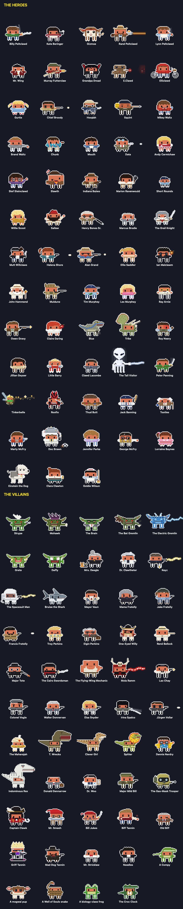
</p>

## Window mode

Clawd Clash opens in a window by default (switch to the desktop from the menu). The whole crew stands in a scene, and every session gets a card: its project, what it's doing right now, your last prompt, its last reply, and its agents in a little tree underneath.

<p align="center">
  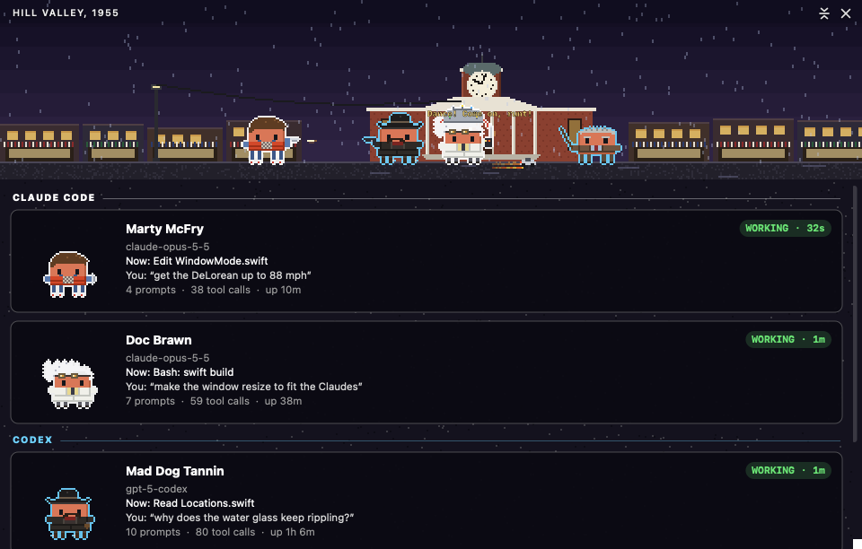
</p>

The scene is set **where the first session's character belongs**: the idol temple for Indiana Bones, the Orca for Chief Broody, Kingston Falls for Billy, the Goondocks for the Goonies, the T. rex paddock for T. Wrecks, the Jolly Roger for Captain Clawk:

<p align="center">
  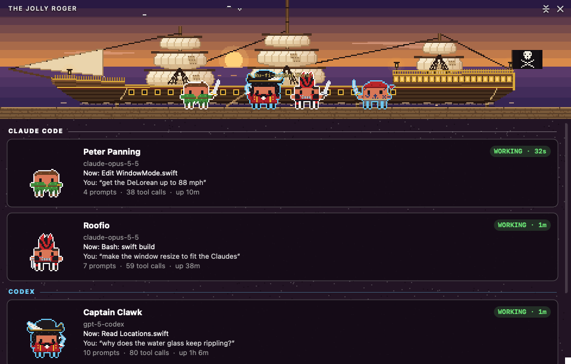
</p>

23 hand-built places, each with its own little animation: lightning strikes the courthouse clock in Hill Valley's storm; the neon flickers at Biff's Pleasure Paradise; a steam train puffs through Hill Valley in 1885; the flags flap on Amity Island; the Orca bobs among yellow barrels; snow falls on Kingston Falls; the bike crosses the moon over Elliott's hill; the lighthouse beam sweeps the Goondocks; the boulder waits in the idol temple; lava glows in the Temple of Doom; the gates of Jurassic Park tower over the wall; the mothership's lights shine over Devils Tower; the waterfall runs in Neverland; the Jolly Roger rides at anchor, lanterns lit.

<p align="center">
  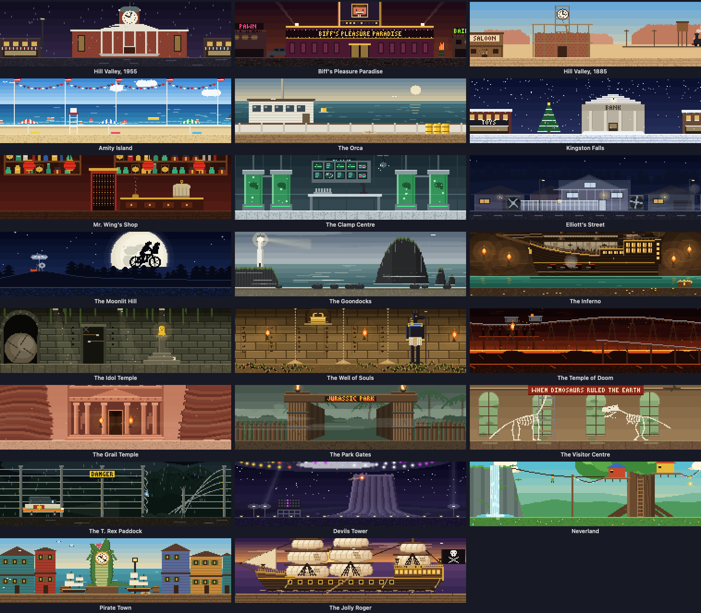
</p>

When the scene moves somewhere new, it goes the way the films would: the bike crosses a full moon that grows into a window onto the new place; the DeLorean hits 88 mph in a white flash; a red line travels across an old map with a little plane following it; a fin cuts through water that rises over the scene; a camera flash leaves a ringing afterimage; the park gates close on the old place and open on the new; the five tones light their panels one by one; the boulder rolls through; Tinkerbelle's pixie dust sweeps across; and One-Eyed Willy's doubloon flips the old place over to the new. Each comes up more often with its own people on screen.

<p align="center">
  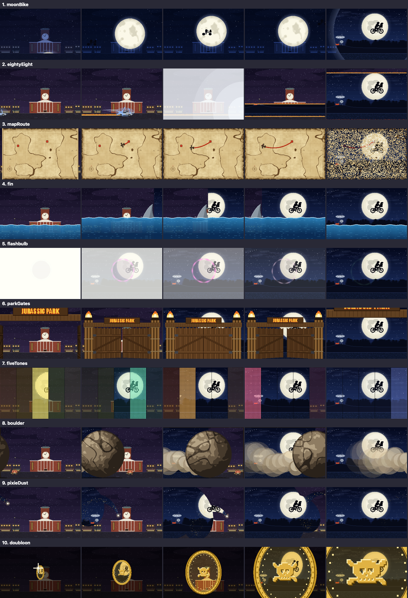
</p>

## Screen saver

<p align="center">
  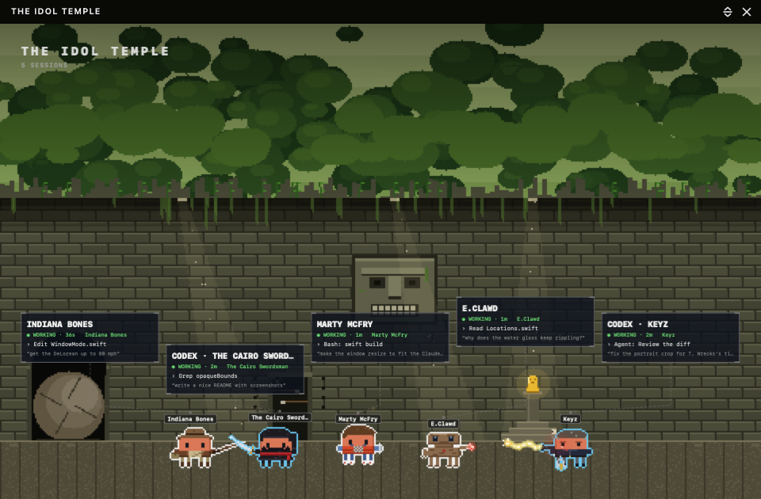
</p>

Clawd Clash comes with a screen saver: the place at full screen and the crew fighting across its floor. Every Claude and agent wears a name tag, each session has a card floating above the crew, a clock sits in the corner, and what happened lately crawls along the bottom. Every 10 minutes it travels somewhere new with one of the transitions above. When there's nothing much to watch, it puts on a show instead: a random crew squaring off, heroes against villains. It even shows your sessions with the app closed. Pick **Stevie Clawdberg** in the screen saver's **Options…** in System Settings.

The window can show the same view, and **Random** location moves the window somewhere new every 10 minutes, the same way.

## Get it

Stevie Clawdberg is part of **[Clawd Clash](https://github.com/rodclemen/clawd-clash)**, one app with multiple universes. It needs macOS 13+ and at least one of the [AIs and harnesses it supports](https://github.com/rodclemen/clawd-clash#supported-ais-and-harnesses).

Stevie Clawdberg isn't released yet. When it is, it comes with the next Clawd Clash release:

```sh
brew tap rodclemen/tap
brew trust rodclemen/tap      # newer Homebrew asks you to trust a third-party tap once
brew install --cask clawd-clash
```

Then pick **Settings → Universe → Stevie Clawdberg**. Or download the zip from [Clawd Clash's releases](https://github.com/rodclemen/clawd-clash/releases), unzip it and drag **Clawd Clash** to Applications.

Everything else (how it works, the settings, uninstalling, the source and contributing) lives in the **[Clawd Clash repo](https://github.com/rodclemen/clawd-clash)**.

## More universes

Stevie Clawdberg is one of multiple universes. In **Settings → Universe** you can switch to **[Star Clawds](https://github.com/rodclemen/star-clawds)**, **[Marvelous Clawds](https://github.com/rodclemen/marvelous-clawds)**, **[Detective Clawds](https://github.com/rodclemen/detective-clawds)**, **[Doctor Clawd](https://github.com/rodclemen/doctor-clawd)** or **[The Clawd Files](https://github.com/rodclemen/the-clawd-files)**, or pick **Random** to change universe on its own every so often. Switching recasts everyone on screen and moves the scene to one of the new universe's places. Or pick **Clawd Royale** to throw every cast into one scene, each character as themselves, in a new place from any universe every ten minutes.

## What's new

The highlights, in plain words: [CHANGELOG.md](CHANGELOG.md). The full history lives in Clawd Clash.

---

<p align="center"><sub>An independent parody fan project, not affiliated with or endorsed by Steven Spielberg, Amblin Entertainment, Universal Pictures, Lucasfilm, Warner Bros. or the makers of any of the films. Claude and Clawd belong to Anthropic.<br>Free to use: <a href="LICENSE">MIT licensed</a>.</sub></p>
